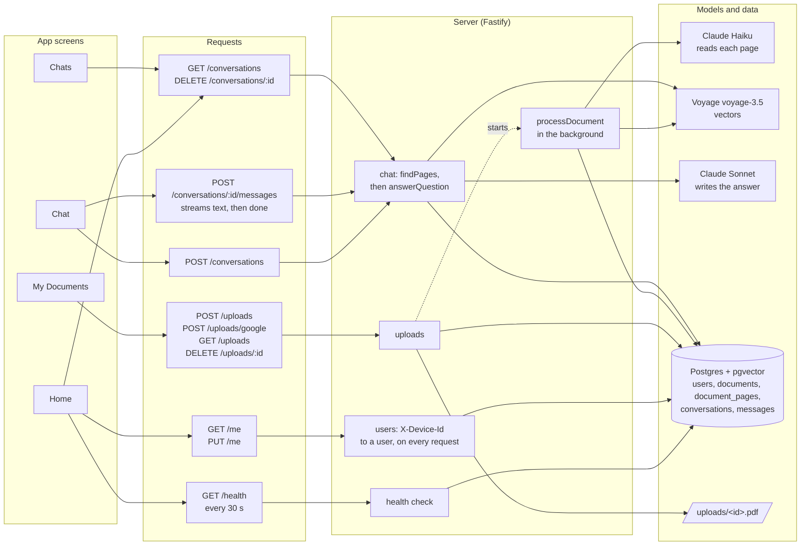
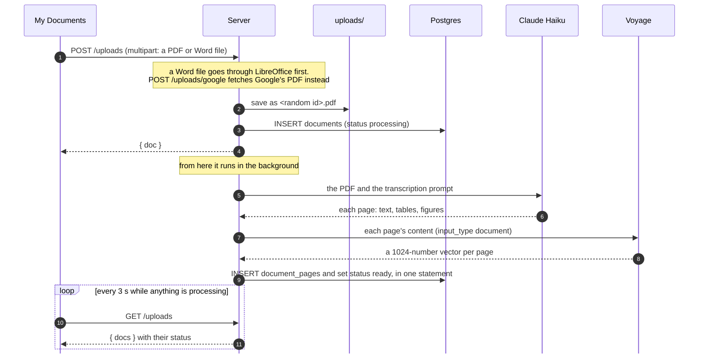
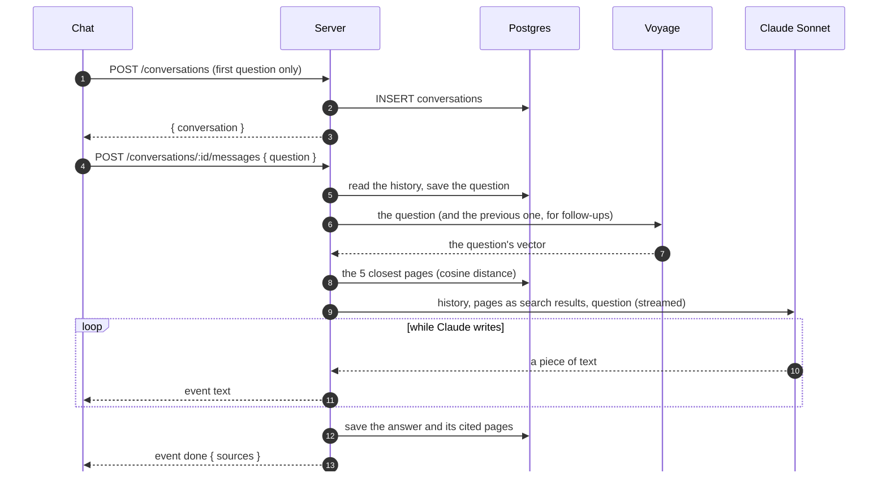

# Multimodal RAG — Chat with your documents

Add your PDFs, Word files or Google Docs, ask questions in your own words, and get answers that name the pages they came from.

The app reads every page, including tables, charts and pictures, so it can answer questions about a chart as well as about the text. Each answer lists the pages it used, so you can check it.

It's a pnpm monorepo:

| Part          | What it is                                                                             | Docs                               |
| ------------- | -------------------------------------------------------------------------------------- | ---------------------------------- |
| `apps/mobile` | The app: iOS, Android and web, built with [One](https://onestack.dev) and React Native | [docs/app.md](docs/app.md)         |
| `apps/server` | The API: Fastify, Postgres with pgvector, Claude and Voyage                            | [docs/server.md](docs/server.md)   |
| `postman`     | A Postman collection for every route the app uses                                      | [docs/postman.md](docs/postman.md) |

## How it works

Two flows do all the work:

1. **Adding a document.** The server saves the file and returns at once. Word files (`.doc`, `.docx`) are turned into a PDF first, with LibreOffice, and a Google Doc is fetched from Google as a PDF, so from here on every document is a PDF. In the background, Claude Haiku reads the whole PDF and writes out each page: its text, its tables, and its charts and pictures, with the values a chart plots. Voyage turns each page into a vector (a list of numbers that captures its meaning), and the pages are stored in Postgres.
2. **Asking a question.** Voyage turns the question into a vector as well. Postgres finds the 5 pages closest in meaning, and Claude Sonnet answers using only those pages and cites the ones it used. The answer streams to the app as it's written.

Each install of the app is its own user. It makes a random id once, keeps it in the keychain (or localStorage on web), and sends it as `X-Device-Id` with every request. The server only ever shows a user their own documents and chats. This isn't sign-in: anyone with the id is that user.

## System design

Left to right: each screen, the requests it sends, the server code that handles them, and the models and data behind them.



The header on every screen shows the server status from `GET /health`. That check also queries the database, so the app shows Not connected when either the server or the database is down.

### Adding a document



If any step fails, the document is marked `failed` and the screen shows "Couldn't read".

### Asking a question



If the app leaves or the user taps Stop, the connection closes. The server notices and aborts Claude's stream, so nobody pays for an answer no one will read.

## Run it

You need Node 22.11+, pnpm 10, Docker, an [Anthropic API key](https://console.anthropic.com) and a [Voyage API key](https://www.voyageai.com).

```sh
pnpm install
cp .env.example .env     # then fill in the database settings and both API keys
docker compose up -d     # Postgres on POSTGRES_PORT, pgweb on http://localhost:8082
pnpm --filter @multimodal-rag/server migrate
pnpm dev:server          # http://localhost:3000/health
pnpm run:web             # starts the app's dev server and opens http://localhost:8081
```

`.env` is read by both `docker-compose.yml` and the server, so the database settings can't drift apart.

For iOS or Android, and for running on a phone, see [docs/app.md](docs/app.md).

To check a change in the running app (the API with curl, web with Playwright, iOS on the simulator), follow the `run-app` skill in [.claude/skills/run-app](.claude/skills/run-app/SKILL.md).

## Checks

The pre-commit hook only formats the staged files. Run these before a commit:

```sh
pnpm typecheck && pnpm lint && pnpm deadcode && pnpm format:check
pnpm --filter @multimodal-rag/server test
pnpm --filter @multimodal-rag/mobile test
```
