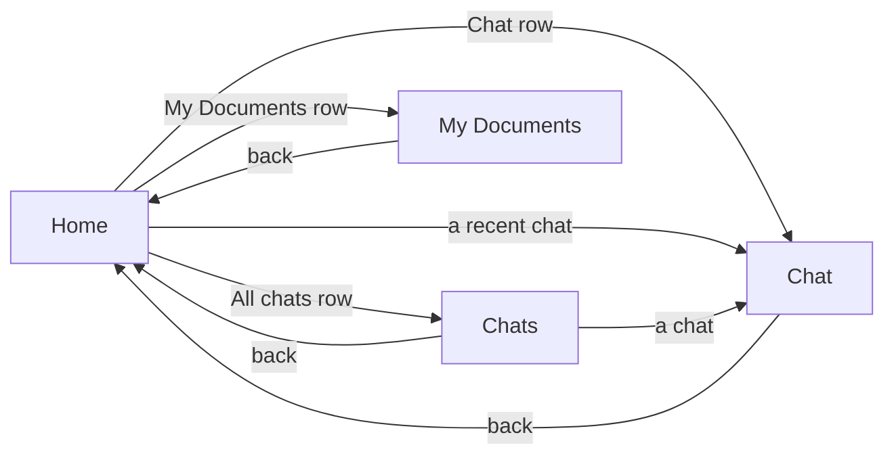
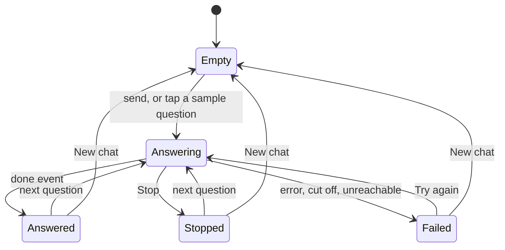

# The app (`apps/mobile`)

One codebase for iOS, Android and web, built with [One](https://onestack.dev) 2.9, React Native 0.88 and React 19.

Native views come first. A screen that is mostly a list uses the platform's own UI: SwiftUI on iOS, Jetpack Compose on Android. The chat screen is React Native, because it redraws markdown many times a second while an answer streams. Even there, the header buttons, icons, share sheet and haptics are native.

## Screens

| Screen       | Route            | iOS                                    | Android      | Web          |
| ------------ | ---------------- | -------------------------------------- | ------------ | ------------ |
| Home         | `/`              | SwiftUI `List`                         | Compose list | React Native |
| My Documents | `/documents`     | SwiftUI `List` with swipe to remove    | Compose list | React Native |
| Chat         | `/chat`          | React Native, with native header items | React Native | React Native |
| Chats        | `/conversations` | SwiftUI `List` with swipe to remove    | Compose list | React Native |



- **Header, on every screen:** the server status.
  - On iOS it's a native bar button. Its icon shows the state (an antenna, an antenna with a slash, or `…` while checking), and its menu names the server and has **Check again**.
  - On Android it's a dot and a word that check again when pressed.
  - On web it sits on the home page.
- **Home** says what the app is for, and shows Chat, All chats and My Documents as rows. The rows are greyed out with a note while the server can't be reached. Below them are the 5 latest chats, and **Your name**, which asks for a name with a native prompt on iOS and the browser's on web (Android has no text prompt, so the row isn't there).
- **My Documents** adds a PDF or Word file with the system file picker, or a Google Doc from its share link, and lists every document with its size and status. The link is asked for with a native prompt on iOS and the browser's on web; Android has no text prompt, so it has no Google Doc button yet. When the server refuses a file, the screen shows its reason, such as a doc that isn't shared. While any document is still being read, it checks the list again every 3 seconds. A swipe (iOS) or the trash button (Android and web) removes a document after a confirm.
- **Chat:**
  - With no messages, it shows three sample questions; tapping one asks it.
  - The message box grows to five lines. Its ↑ button becomes ■ Stop while an answer streams, and a stopped answer keeps its text.
  - Each answer shows its source pages as pills, with Copy and Share underneath. Tapping a pill opens a sheet with the part of that page the answer used, drawn like an answer, so its tables stay tables. On iOS it's SwiftUI's sheet at half height, which drags to full; on Android and web it's a React Native modal with Done.
  - A failed question gets **Try again**.
  - **New chat** in the header starts a new conversation.
  - Opened from a saved chat (`/chat?id=…`), it loads that chat's messages and carries on in it. If they fail to load, it takes no questions and offers **Try again**.
- **Chats** lists every chat, latest first. A swipe (iOS) or the Remove button (Android and web) removes one after a confirm.

## Layout of the code

```
app/                     routes, one file per screen (One's file-based router)
  _layout.tsx            the Stack, the server status provider and the header status button
  index.tsx              Home: picks the iOS, Android or web view
  documents.tsx          My Documents: picks the iOS, Android or web view
  conversations.tsx      Chats: picks the iOS, Android or web view
  chat.tsx               Chat
features/
  home/                  the home screen's words (content.ts) and its three views
  documents/             useDocuments (state, polling) + api.ts + one view per platform
  conversations/         useConversations (loads on focus) + api.ts + one view per platform
  user/                  useMe: the user's name
  chat/
    useChat.ts           the conversation: a reducer, plus send, stop, retry, startOver
    api.ts               createConversation and askQuestion (streams the answer)
    sse.ts               reads server-sent events from the text received so far
    SourceSheet.tsx      the part of a page a source used, in a sheet
    parseMarkdown.ts     turns the answer into blocks (headings, lists, tables) while it streams
    Markdown.tsx         draws those blocks
    ChatView.tsx         the screen
    ChatHeader.tsx       New chat beside the server status
  server/
    config.ts            the server URL
    deviceId.ts          this install's id, made once and kept in the keychain or keystore
    apiFetch.ts          fetch with the X-Device-Id header
    useServerStatus.ts   the health check
    ServerStatus.tsx     the provider that shares one check with every screen, and the badge
    serverStatusMenu.tsx the iOS header menu
  theme.ts               colors and shared styles
  systemColor(.native).ts iOS system colors on native, light colors on web
  SystemIcon.tsx         an SF Symbol on iOS, a character elsewhere
__tests__/               Jest tests (they render the web views)
```

A screen with views per platform uses this pattern:

```ts
// SwiftUI and Compose views throw on the wrong platform, so pick one per platform
const views = { ios: HomeIOS, android: HomeAndroid, web: HomeWeb };
const HomeView = views[One.platform];
```

## How the chat works

React Native's `fetch` can't stream a response body. `askQuestion` therefore sends the question with `XMLHttpRequest` and reads `responseText` on each `onprogress`.

The server sends [server-sent events](https://developer.mozilla.org/en-US/docs/Web/API/Server-sent_events): `text` for each piece of the answer, `done` with the sources, and `error` if answering fails. A chunk can end halfway through an event, so `parseEvents` returns the complete events and keeps the rest for the next chunk.



- **The conversation is created lazily.** It's made with the first question, so opening the screen costs nothing.
- **One AbortController per question.** It's kept in a ref, so a second tap before the next render can't send the question twice.
  - Stop aborts it, closing the screen aborts it, and New chat aborts it.
  - Aborting closes the connection, and the server then stops Claude.
  - A request that started before New chat never writes into the new chat.
- **Finished turns aren't redrawn.** They keep the same object, and `TurnRow` is memoized, so only the turn being answered is redrawn with each new piece of text.
- **The list follows the answer** only while it's scrolled to the end. If you scroll up to read, it stays where you are.

## The server URL

`features/server/config.ts` picks the URL:

| Where the app runs | URL                                                       |
| ------------------ | --------------------------------------------------------- |
| iOS simulator, web | `http://localhost:3000`                                   |
| Android emulator   | `http://10.0.2.2:3000` (the emulator's name for your Mac) |
| A real phone       | `VITE_SERVER_URL` in `apps/mobile/.env`                   |

For a phone, use your Mac's address on the same Wi-Fi network:

```sh
# apps/mobile/.env
VITE_SERVER_URL=http://192.168.0.126:3000
```

## Run it

```sh
pnpm run:web                                      # dev server + opens http://localhost:8081
pnpm run:ios                                      # dev server + iOS simulator
pnpm run:android                                  # dev server + Android emulator
pnpm --filter @multimodal-rag/mobile prebuild:native   # regenerate ios/ and android/
```

`pnpm run:*` refuses to start if something is already answering on port 8081, since it would open the wrong app.

### Links

The app registers the `ragchat` scheme, and the router matches its links like Expo Router does. `ragchat:///chat?id=<conversation id>` opens that chat, and `ragchat:///documents` and `ragchat:///conversations` open those screens. On the simulator:

```sh
xcrun simctl openurl booted "ragchat:///conversations"
```

The scheme is set in `vite.config.ts` (`native.app.scheme` and `router.linking.scheme`), and prebuild writes it into `Info.plist` and the Android manifest, so changing it needs a native rebuild.

### On an iPhone, with Xcode's command-line tools

A Debug build loads its JavaScript from the dev server, so start that first (`pnpm dev:mobile`) and keep the phone on the same Wi-Fi network. To find your phone's id, run `xcrun devicectl list devices`.

```sh
cd apps/mobile/ios
xcodebuild -workspace RagChat.xcworkspace -scheme RagChat -configuration Debug \
  -destination id=<device id> -derivedDataPath build/device -allowProvisioningUpdates build
xcrun devicectl device install app --device <device id> \
  build/device/Build/Products/Debug-iphoneos/RagChat.app
xcrun devicectl device process launch --device <device id> --terminate-existing dev.arberihh.ragchat
```

After a JavaScript change, launch the app again with the last command; it downloads the new code. Rebuild only when the native project changes.

## Tests

```sh
pnpm --filter @multimodal-rag/mobile test
```

Jest renders the web views, because SwiftUI and Compose only render in native builds. The tests mock `one` with `One.platform: "web"`, and they swap `XMLHttpRequest` for a fake request. The fake lets a test feed the answer one piece at a time and check the screen between pieces.

A mock must behave like the One API it stands in for. One's `useFocusEffect(effect, deps)` takes its deps as the second argument, unlike React Navigation's, and a mock that re-ran on every new callback once hid a bug where the home screen never loaded its chats.

To check a change in the running app, follow the `run-app` skill in `.claude/skills/run-app`: it starts everything, walks through the web app with Playwright and opens each screen on the iOS simulator by link.

## Known gaps

- **Release builds fail.** They fail while bundling the JavaScript: rolldown reports "UMD and IIFE are not supported for code-splitting builds". This only happens with `app/_layout.tsx` included, and the cause isn't found yet. Debug builds work.
- **Android hasn't run on a device.** The Compose views have only been typechecked.
- **Android and web keep the light colors** in dark mode.
- **Android can't add a Google Doc,** because it has no text prompt to paste the link into.
- **A source shows the part it used, not the page itself.** The quote is the text the server read from the page, so it doesn't show the page's layout.
- **The Android source sheet isn't Compose.** It's a React Native modal, because a Compose sheet holding React Native views hasn't been tried on a device.
