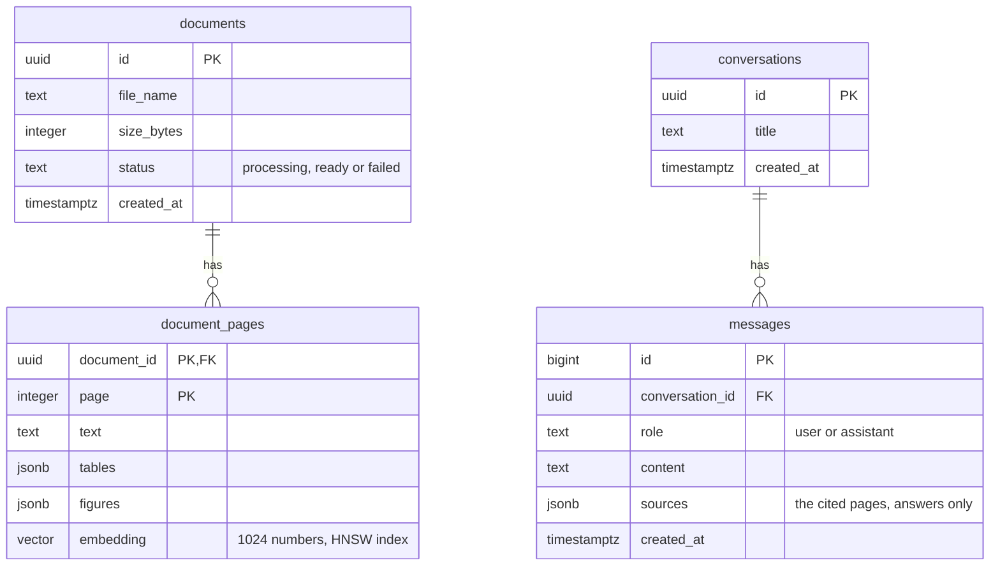

# The server (`apps/server`)

A Fastify API on Node 22, run with `tsx`. It keeps documents and conversations in Postgres, finds pages by meaning with pgvector, reads PDFs with Claude Haiku, makes vectors with Voyage, and writes answers with Claude Sonnet.

```sh
pnpm --filter @multimodal-rag/server dev       # watch mode, http://localhost:3000
pnpm --filter @multimodal-rag/server start     # no watch
pnpm --filter @multimodal-rag/server migrate   # apply new migrations
pnpm --filter @multimodal-rag/server test
```

It listens on `0.0.0.0`, so a phone on the same network can reach it. The port is `PORT`, or 3000 if `PORT` isn't set. It reads `.env` from the repo root.

## Routes

| Method   | Route                         | Used by       | What it does                                                                                |
| -------- | ----------------------------- | ------------- | ------------------------------------------------------------------------------------------- |
| `GET`    | `/health`                     | header, Home  | `{ status: "ok" }` if the database answers, 503 `{ status: "database unreachable" }` if not |
| `POST`   | `/uploads`                    | My Documents  | Saves a PDF (multipart field `file`, up to 100 MB) and starts reading it                    |
| `GET`    | `/uploads`                    | My Documents  | Every document, newest first, with its status                                               |
| `DELETE` | `/uploads/:id`                | My Documents  | Removes the document, its pages and its file. 204, or 404 if it doesn't exist               |
| `POST`   | `/conversations`              | Chat          | Starts a conversation. 201 `{ conversation }`                                               |
| `POST`   | `/conversations/:id/messages` | Chat          | Answers `{ question, document? }` as a stream of server-sent events                         |
| `GET`    | `/conversations/:id/messages` | —             | The conversation's messages, in order, with the sources of each answer                      |
| `GET`    | `/search?q=&limit=&document=` | — (debugging) | The pages closest in meaning to `q`, with their scores                                      |
| `GET`    | `/extract/:id`                | — (debugging) | What Claude read from each page of a document                                               |

Ids are UUIDs. An id that isn't a UUID gets a 400 from the route schema, rather than a 500 from Postgres.

### The answer stream

`POST /conversations/:id/messages` answers with `Content-Type: text/event-stream`:

```
event: text
data: {"text":"Revenue in Q2 "}

event: text
data: {"text":"was **…** (p. 3)."}

event: done
data: {"sources":[{"documentId":"…","fileName":"quarterly-report.pdf","page":3}]}
```

If answering fails, the last event is `error` with `{ "error": "Could not answer the question" }` instead of `done`. If the client closes the connection before the end, the server aborts Claude's stream and saves only the question.

## Reading a PDF

`POST /uploads` returns as soon as the file and its row are saved. It then starts `processDocument` (`src/extract/process.ts`) without waiting for it:

1. **Read.** `extractPages` sends the whole PDF to **Claude Haiku** (`claude-haiku-5-5`) with a transcription prompt and a Zod output format. For each page it gets back:
   - the body text as markdown;
   - every table as markdown;
   - every chart, diagram or photo, with its type, its text, a description, and for charts the plotted values as a table. Estimated values are marked `~`.
     PDFs over 20 MB are rejected, because the API takes 32 MB and base64 adds a third.
2. **Embed.** `pageContent` joins each page's text, tables and figures into one text. **Voyage** (`voyage-3.5`, `input_type: document`) turns each of those texts into 1024 numbers. Blank pages get no vector. Pages go to Voyage 16 at a time, and the batches run in parallel.
3. **Save.** One SQL statement inserts every page with its vector and sets the document to `ready`, so the two can't get out of step.

`processDocument` never throws. If any step fails, the document is marked `failed`. Each step logs its model, page and table counts, tokens used and time taken.

## Answering a question

`src/chat/index.ts`, then `src/chat/answer.ts`:

1. Check the conversation exists, read its history, and save the question.
2. **Find pages.** `findPages` embeds the question with Voyage (`input_type: query`), and pgvector returns the 5 nearest pages by cosine distance. The search uses an HNSW index. For a follow-up like "and in Q3?", it searches with the previous question too, since the follow-up has no topic of its own. Pass `document` to search one document only.
3. **Answer.** **Claude Sonnet** (`claude-sonnet-5-5`) gets the history, then each page as a `search_result` block with citations on, then the question. The system prompt tells it to:
   - answer only from the pages, and say so when the answer isn't there;
   - cite the pages it used;
   - keep the answer short;
   - use only the markdown the app can draw: bold, bullets, numbered lists, `##` headings and tables.
4. **Stream.** Each piece of text goes to the app as a `text` event. At the end, the pages Claude actually cited become the `sources`. They're saved with the answer and sent in `done`.

## Data



- **Deletes cascade.** Deleting a document deletes its pages, and deleting a conversation deletes its messages.
- **Files live on disk.** Each PDF is saved as `uploads/<id>.pdf`, named with a random id so the client's file name never decides where the server writes.
- **Migrations** live in `migrations/` and are applied with Postgrator, which records them in the `migrations` table. Never edit a migration that has already been applied; add a new one.
- **Browsing the tables:** `docker compose up -d` also starts a read-only [pgweb](http://localhost:8082).

## Configuration

`.env` in the repo root. `docker-compose.yml` reads the same file, so the database settings can't drift apart.

| Variable                                                             | Used for                                                       |
| -------------------------------------------------------------------- | -------------------------------------------------------------- |
| `POSTGRES_USER`, `POSTGRES_PASSWORD`, `POSTGRES_DB`, `POSTGRES_PORT` | The database. The server connects to `localhost:POSTGRES_PORT` |
| `ANTHROPIC_API_KEY`                                                  | Reading PDFs and writing answers                               |
| `VOYAGE_API_KEY`                                                     | Page and question vectors                                      |
| `PORT`                                                               | The server's port (default 3000)                               |
| `NODE_ENV=production`                                                | JSON logs instead of the readable dev logs                     |

## Robustness

- **The database goes away.** The pool listens for `error`, so a connection the database drops is logged instead of crashing the server. `/health` answers 503 until the database is back, and the pool reconnects on the next query.
- **The app leaves mid-answer.** The server sees the connection close before the reply has ended, and aborts Claude's stream.
- **A failed upload.** If saving the file or its row fails (the file is too big, or the database is down), the half-written file is removed.

## Tests

```sh
pnpm --filter @multimodal-rag/server test
```

Node's test runner with `tsx`. Claude and Voyage are replaced by fakes passed in as arguments: `answerQuestion` and `processDocument` take a `client`, and `findPages` takes an `embed`. So the tests don't use the network or cost anything.

## Known gaps

- **There are no users or auth.** The `users` table from the first migration is unused, and every client sees every document.
- **A retried question is saved twice.** The question is saved before answering, so when an answer fails and the user taps Try again, the conversation's history holds it twice.
- **The comment in migration 006 is wrong.** It says the vectors come from `voyage-4`, but the code uses `voyage-3.5`. Both return 1024 numbers.
- **The app polls for status.** It asks again every 3 s while a document is being read, because the server can't tell it when the document is done.
